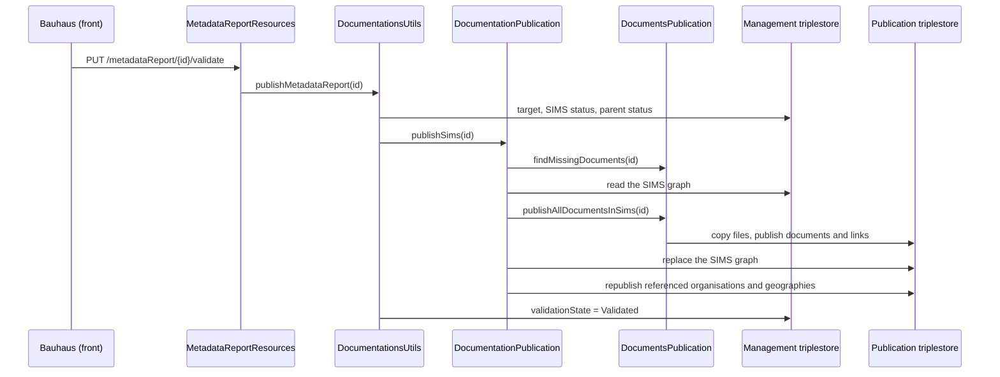

This page follows what happens when a user clicks **Publish** on a metadata report (SIMS), from the button down to the management and publication triplestores.

## 1. Front end

| Step                                                                                                    | File                                                                              |
| ------------------------------------------------------------------------------------------------------- | --------------------------------------------------------------------------------- |
| Button, hidden unless the user holds `OPERATION_SIMS / PUBLISH` on one of the owner stamps              | `modules-operations/pages/sims/view/menu.tsx`                                     |
| `PUT metadataReport/{id}/validate` call                                                                 | `sdk/operations/sims.ts`                                                          |
| Mutation; global error toast disabled (`globalErrorToast: false`); invalidates `["sims", id]` on success | `modules-operations/hooks/useSims.ts` (`usePublishSims`)                          |
| Error handling                                                                                          | `modules-operations/pages/sims/view/components/SimsVisualization.tsx` (`publish`) |

`SimsVisualization` handles a failed publication as follows:

- code `862` (`SIMS_PUBLICATION_MISSING_DOCUMENTS`): `params.documents` (comma-separated ids) feeds `MissingDocumentsErrorBloc`, which lists the labels of the missing documents;
- a code known to the `errors.*` catalogue (e.g. `804`, unpublished target): translated message, with the `id` and a link to the parent (`getParentUri`);
- any other code: raw `ErrorBloc` (e.g. publication repository unavailable).

Only `["sims", id]` is invalidated after a publication. Saving a SIMS, by contrast, also invalidates documents, series, operations and indicators.

## 2. Back end — preliminary checks

`DocumentationsUtils.publishMetadataReport(id)` runs, in order:

1. **Target**: `getDocumentationTargetTypeAndId(id)` — operation, series or indicator. Missing → 404 `SIMS_UNKNOWN_TARGET`.
2. **Already published**: `PublicationUtils.rejectIfAlreadyPublished` on the `insee:validationState` read from the SIMS graph (`getPublicationStatusQuery.ftlh`). `Validated` → 400 `ALREADY_PUBLISHED`. `Modified` is accepted: it is the normal republication case.
3. **Published parent**: status of the target (`OperationsParentRepository.getValidationStatus`, family/operation/series first, then indicator). `Unpublished` or undefined → 400 `OPERATION_VALIDATION_UNPUBLISHED_PARENT` (`params.id` = target id).

Then `DocumentationPublication.publishSims(id)`:

4. Blank `simsId` → 400.
5. **Missing documents**: `DocumentsPublication.findMissingDocuments` checks that every referenced file exists in the management storage (`DocumentsUtils.existsInStorage`, the same check as the export). A single missing file → `RmesMissingDocumentsException` (400, code 862), **before any write**.
6. Empty SIMS graph in management → 404 `SIMS_UNKNOWN_ID`.

## 3. Back end — writing to the publication repository

SIMS graph: `RdfUtils.simsGraph(id)` = `<documentationsGraph>/{id}`.

### 3.1 Building the model (`publishSims`)

The whole graph is read from management (`repoGestion.getCompleteGraph`), then for each triple:

- **filtering**: predicates ending with `S.1.3` … `S.1.8` and `validationState` are not published (`RUBRICS_NOT_FOR_PUBLICATION`);
- **IRI rewriting**: `PublicationUtils.tranformBaseURIToPublish` replaces the management base URI with the publication one on subject, predicate and IRI object;
- **rich text**: `dcmitype:Text` resources get, alongside their Markdown `rdf:value`, an `insee:html` (Markdown → XHTML, `XhtmlToMarkdownUtils.markdownToXhtml`);
- **referenced resources**: IRI objects containing the organisations graph or the geography base URI (`documentationConfiguration.geographie()`) are collected for step 3.4.

### 3.2 Documents and links (`publishAllDocumentsInSims`)

Runs during 3.1, before the SIMS graph is written.

For each document of the SIMS (`getListDocumentSims`):

1. the physical file is copied from `directoryGestion` to `directoryPublication` (`FilesOperations.copy`);
2. the document is published as RDF: its URL is rewritten to `documentsStorage.baseUrl()/{file}`, the other triples move to the publication base URI. If reading through `getStatements` fails, a SPARQL query (`getDocumentPredicatesAndObjects`) takes over and writes into `documentsGraph()`.

For each link (`getListLinksSims`): published as RDF, IRIs rewritten.

Each document and link is replaced through `RepositoryPublication.publishResource`: every triple of the subject is removed, then the new ones are added.

### 3.3 The SIMS graph

`RepositoryPublication.publishContext(graph, model, "sims")`: `CLEAR` of the graph in the publication repository, then the model is added. Full replacement: a rubric emptied in management disappears from publication.

### 3.4 Organisations and geographies

Each resource collected in 3.1 is republished by `PublicationUtils.publishResource` (triples read from management, IRIs rewritten, blank nodes followed recursively).

### 3.5 Status in management

Back in `DocumentationsUtils`, `repoGestion.objectValidation` removes `insee:validationState` / `insee:isValidated` from the SIMS and sets `Validated` in its graph.

## 4. Status lifecycle

| Event                                       | `insee:validationState` |
| ------------------------------------------- | ----------------------- |
| Creation, or save of a never-published SIMS | `Unpublished`           |
| Save of a `Validated` or `Modified` SIMS    | `Modified`              |
| Successful publication                      | `Validated`             |
| Republication of a `Validated` SIMS         | rejected (400)          |
